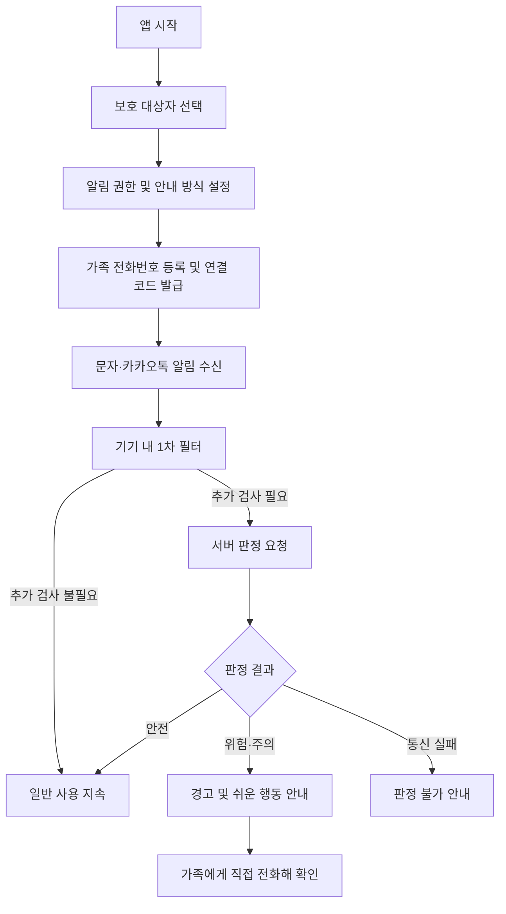
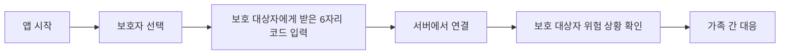

# SafeLink

### 의심하지 않아도, 가족과 함께 안전하게

**SafeLink는 의심스러운 문자·카카오톡 알림을 감지하고, 이해하기 쉬운 경고와 가족의 대응을 연결하는 AI 기반 디지털 안전 서비스입니다.**

디지털 환경에 익숙하지 않은 사람도 스미싱·사칭 메시지를 스스로 분석하지 않고 위험을 인지할 수 있도록 돕는 것을 목표로 합니다.

> **프로젝트 주제** AI 기반 사기 문자 자동 감지 및 가족 알림 서비스  
> **개발 환경** Android  ·  **프로젝트 유형** 해커톤  ·  **대상** 디지털 취약계층 및 보호자

---

## 1. 프로젝트 배경

스미싱과 가족·기관 사칭 메시지는 단순한 악성 링크뿐 아니라, 긴급한 상황을 가장해 송금이나 개인정보 제공을 유도하는 방식으로도 발생합니다. 하지만 이용자가 먼저 메시지를 의심하고 직접 조회해야 하는 대응 방식은 디지털 정보에 익숙하지 않은 사람에게 부담이 될 수 있습니다.

SafeLink는 이 문제를 **사용자의 판단에만 맡기지 않는 사전 경고**로 해결하고자 합니다.

- **먼저 감지합니다.** 사용자가 메시지를 복사하거나 신고하기 전에 알림을 대상으로 의심 여부를 확인합니다.
- **쉽게 설명합니다.** 복잡한 보안 용어 대신 위험 이유와 지금 해야 할 행동을 안내합니다.
- **함께 대응합니다.** 보호자와 보호 대상자를 연결해 위험 상황에 공동으로 대응할 수 있도록 설계했습니다.

## 2. 핵심 기능

| 기능 | 설명 |
| --- | --- |
| **문자·카카오톡 알림 감지** | Android 알림 접근 서비스를 이용해 지원되는 문자 앱과 카카오톡의 알림을 확인합니다. |
| **기기 내 1차 필터링** | 가족 사칭, 송금 유도, 의심 링크 등 규칙 기반 신호를 검사하고 필요한 메시지를 판정 API로 전달하도록 구성했습니다. |
| **위험도별 경고** | 위험·주의·검사 중·검사 실패 상황에 따라 오버레이, 시스템 알림, 상세 경고 화면을 제공합니다. |
| **맞춤형 안내** | 기본 알림, 화면 안내 중심, 쉬운 안내, 음성 안내 중심 모드를 선택할 수 있습니다. |
| **다국어 지원** | 한국어·영어·베트남어·중국어 경고 표시를 지원하도록 화면을 구성했습니다. |
| **가족 연결** | 보호 대상자가 6자리 연결 코드를 발급받고 보호자가 입력하는 페어링 흐름을 구현했습니다. 서버 연결이 필요합니다. |
| **가족에게 전화하기** | 사전에 등록한 신뢰할 수 있는 번호를 전화 앱에 입력해 직접 확인할 수 있도록 안내합니다. 실제 발신은 이용자가 결정합니다. |
| **보호자 위험 알림** | 위험 판정 결과를 보호자에게 전달하는 FCM 기반 푸시 알림 구조를 설계했습니다. 최종 연동·수신 검증은 별도로 필요합니다. |

### 접근성을 고려한 경고

이용자는 초기 설정에서 자신의 상황에 맞는 알림 방식을 선택할 수 있습니다.

- **화면 안내 중심:** 큰 글씨, 화면 중심 안내 및 진동
- **쉬운 안내:** 짧고 단순한 행동 문구
- **음성 안내 중심:** 음성 안내와 화면 읽기 기능을 고려한 구성
- **기본 알림:** 일반적인 경고 화면과 안내

위험을 알리는 방식은 달라도, **“돈을 보내지 마세요”**, **“가족에게 직접 전화로 확인하세요”**처럼 행동을 구체적으로 제시한다는 원칙은 같습니다.

## 3. 서비스 이용 흐름

### 보호 대상자



### 보호자



> 보호자 푸시 알림 및 알림 이력의 실제 동작은 백엔드·Firebase 연동 상태에 따라 달라집니다.

## 4. AI 판정 구조

SafeLink는 **빠른 기기 내 1차 확인 → 서버의 정밀 판정**으로 이어지는 단계적 분석을 지향합니다.

1. **기기 내 1차 필터:** 발신 정보와 사기 관련 문구·링크 패턴을 확인해 추가 검사 대상을 추립니다.
2. **사기 유형 분석(백엔드 설계):** 가족·기관 사칭, 송금 요구, 앱 설치 유도 등 메시지의 의도와 문맥을 분석합니다.
3. **URL 위험 검사(백엔드 설계):** 링크가 포함된 경우 악성 URL 여부 등을 확인하도록 설계했습니다.
4. **위험도 반환:** 서버의 판정 결과를 `danger`(위험), `caution`(주의), `safe`(안전)로 받아 적절한 화면을 표시합니다.

**링크가 없는 사기 메시지**도 분석 대상으로 고려한다는 점이 핵심입니다. 예를 들어 가족을 사칭해 계좌 이체를 요청하는 문자에는 URL이 없어도 주의가 필요합니다.

현재 저장된 Android 코드에는 규칙 기반 1차 필터와 `/judge` API 연동 코드가 포함되어 있습니다. **LLM 분석 및 URL 평판 검사의 실제 서버 구현·정확도는 별도 백엔드 코드와 통합 테스트를 통해 확인해야 합니다.**

## 5. 기술 스택

| 구분 | 기술 | 활용 |
| --- | --- | --- |
| Android 앱 | **Kotlin**, **Jetpack Compose**, **Material 3** | 앱 화면과 상태 관리 |
| 알림 감지 | `NotificationListenerService` | 지원 앱의 수신 알림 확인 |
| 위험 경고 | Android Overlay, Notification API | 다른 앱 위 경고 및 시스템 알림 |
| 비동기 처리 | Kotlin Coroutines | 필터링과 서버 요청 처리 |
| API 통신 | `HttpURLConnection`, `org.json` | HTTP 요청·응답 처리 |
| 서버 연동 | **FastAPI** 기반 API 계약 | 판정, 사용자 등록, 보호자 연결 |
| 보호자 알림 | **Firebase Cloud Messaging (FCM)** | 보호자 푸시 알림 연동 대상 |
| 디자인·협업 | Figma, GitHub, Android Studio | UI 설계, 버전 관리 및 실행 테스트 |

*상기 기술 중 FCM 및 서버 판정 기능은 Android 앱에 관련 흐름이나 API 계약이 있어도 완전한 통합이 확인되었다는 의미는 아닙니다.*

## 6. 프로젝트 구성

Android 프로젝트 루트 기준 주요 코드입니다.

```text
app/src/main/java/com/hackathon/ansimmessagepractice/
├── MainActivity.kt           # 앱 진입점
├── navigation/               # 역할별 화면 전환
├── ui/
│   ├── onboarding/           # 시작·권한·언어·사용자 유형 설정
│   ├── warning/              # 위험도별 경고와 맞춤 안내
│   └── history/              # 위험 이력 상세 화면
├── detection/                # 알림 감지·1차 필터·위험 알림
├── guardian/                 # 보호자 화면·코드 연결·전화하기
├── overlay/                  # 다른 앱 위의 경고창
└── data/api/                 # 판정·사용자·보호자 API 연동
```

## 7. 실행 방법

### 요구 환경

- Android Studio 및 프로젝트에 필요한 Android SDK
- Android **8.0(API 26) 이상** 에뮬레이터 또는 실기기
- 서버 연동 시 접근 가능한 백엔드 주소

### Android 앱 실행

1. 저장소를 Clone하고 `settings.gradle.kts`가 있는 **Android 프로젝트 루트**를 Android Studio에서 엽니다.
2. Gradle Sync를 완료합니다.
3. 에뮬레이터 또는 안드로이드 실기기를 선택해 앱을 실행합니다.
4. 앱에서 **보호 대상자 / 보호자 역할**을 선택하고 필요한 권한을 설정합니다.
5. 실제 알림 수신 테스트는 지원되는 문자 앱 또는 카카오톡의 알림이 표시되는 환경에서 진행합니다.

### 백엔드 연결

서버를 연결하려면 다음 파일의 `SERVER_URL`을 실제 접근 가능한 주소로 설정합니다.

`app/src/main/java/com/hackathon/ansimmessagepractice/data/api/BackendApi.kt`

```kotlin
object BackendConfig {
    private const val SERVER_URL = "https://your-server.example.com"
    // ...
}
```

- 서버가 연결된 경우 `POST /judge` 등을 통해 실제 판정 결과를 받아오도록 구성되어 있습니다.
- 서버 주소가 비어 있으면 **규칙 기반 로컬 시연 경고**를 사용할 수 있지만, 이는 AI 판정 결과가 아닙니다.
- 에뮬레이터의 `10.0.2.2`는 **해당 컴퓨터에서 실행 중인 로컬 서버**에 접근할 때 사용하는 주소입니다. 팀원의 다른 PC에서 실행 중인 서버 주소로 사용할 수 없습니다.
- Firebase 연동 시에는 Android 앱 등록, 관련 Gradle 설정, FCM 토큰 등록 및 백엔드와의 연결이 추가로 필요합니다.

### 주요 API 연동 지점

| API | 목적 |
| --- | --- |
| `GET /health` | 서버 연결 확인 |
| `POST /users/register` | 사용자 등록 |
| `POST /judge` | 의심 메시지 판정 요청 |
| `POST /guardian/pairing-code` | 보호 대상자 연결 코드 발급 |
| `POST /guardian/connect` | 보호자의 연결 코드 입력 |
| `DELETE /guardian/disconnect` | 보호자 연결 해제 |
| `GET /guardian/{device_id}/notifications` | 보호자 알림 이력 조회 |

## 8. 구현 현황 및 검증 범위

이 문서는 **Android 프론트엔드 제출본을 기준**으로 작성했습니다. 다른 팀원의 백엔드 저장소 및 최종 통합 빌드는 이 문서 작성 시점에 별도로 확인되지 않았습니다.

| 구분 | 프론트엔드 코드 기준 상태 |
| --- | --- |
| 역할 선택·온보딩·화면 이동 | 구현 코드 포함 |
| 알림 감지·기기 내 규칙 필터 | 구현 코드 포함 |
| 위험도별 오버레이·시스템 알림·상세 화면 | 구현 코드 포함 |
| 맞춤 안내·4개 언어 화면 | 구현 코드 포함 |
| 보호자 코드 발급·입력·해제 | 화면 및 API 호출 코드 포함, 실제 서버 연결 필요 |
| AI/URL 판정 | API 요청·응답 처리 코드 포함, 서버 동작 별도 확인 필요 |
| 보호자 FCM 푸시 | 최종 설정 및 실제 수신 검증 필요 |
| 앱 전체 통합 테스트 | 서버·권한·기기별 최종 검증 필요 |

### 이용 시 유의사항

- 이 앱은 사기 위험을 **보조적으로 판단**하며, 경고가 없다고 메시지의 안전이 보장되는 것은 아닙니다.
- 알림 수신 및 오버레이는 Android 버전, 기기 설정, 앱 알림 정책과 권한 상태의 영향을 받습니다.
- 시스템 알림과 잠금화면 알림의 외형은 Android OS가 제어하므로 기기별 차이가 있을 수 있습니다.
- 전화하기 버튼은 전화 앱을 열어 번호를 미리 입력하며, 통화를 자동으로 시작하지 않습니다.
- 잠금화면 시스템 경고에는 원문 메시지나 발신자 정보를 직접 노출하지 않도록 구성했습니다. 서버 연동 시에는 추가 검사에 필요한 메시지 정보가 백엔드로 전송될 수 있으므로 실제 운영 단계에서 개인정보 보호 및 접근 통제 검토가 필요합니다.

## 9. 팀 구성

| 역할 | 담당 영역 |
| --- | --- |
| 기획·디자인 (1명) | 문제 정의, 사용자 경험, 와이어프레임, 발표 기획 |
| 프론트엔드 (2명) | Android 알림 감지, 화면·권한·경고 UI 구현 |
| 백엔드 (2명) | 판정 API, 서버·DB, 사용자 연결, 보호자 알림 연동 |

---

### SafeLink가 지향하는 가치

> **위험을 알아차릴 수 있는 사람만 보호받는 것이 아니라, 누구나 가족과 함께 보호받을 수 있는 디지털 환경.**  
> SafeLink는 디지털 취약계층의 안전한 일상을 위해 기술이 먼저 위험을 알리는 서비스를 지향합니다.
