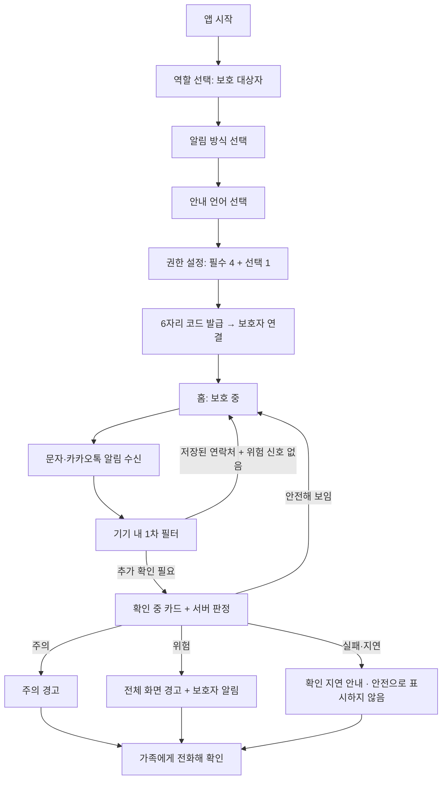
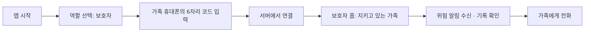

# 모두안심 프론트엔드

### 모두를 지키는 문자 안전망

**모두안심은 의심스러운 문자·카카오톡 알림을 먼저 확인하고, 사용자에게 맞는 방식으로 경고하며, 위험할 때는 가족에게 알리는 AI 기반 사기 문자 감지 서비스입니다.**

사용자가 문자를 복사하거나 직접 조회하지 않아도 동작하는 것을 목표로 합니다. 어르신, 시각·청각·발달장애인, 외국인 주민처럼 기존 예방 서비스에서 빠지기 쉬운 사람도 이해할 수 있는 경고를 제공합니다.

> **프로젝트 주제** AI 기반 사기 문자 자동 감지 · 가족 알림 서비스 · 
> **개발 환경** Android · **대상** 디지털 취약계층과 보호자

---

## 1. 프로젝트 배경

기존 정부·공공 서비스(피싱안심SOS, 보호나라 스미싱 확인, 여신거래 안심차단, 명의도용 방지서비스)는 모두 **사용자가 먼저 의심하고 움직여야** 작동합니다. 의심 문자를 복사해 붙여넣는 일조차 어려운 사람에게는 예방이 닿지 않습니다.

모두안심은 이 문제를 **사용자의 판단에 맡기지 않는 사전 경고**로 해결합니다.

- **먼저 확인합니다.** 문자·카카오톡 알림이 오면 사용자가 아무것도 하지 않아도 의심 여부를 확인합니다.
- **사람에 맞게 알립니다.** 처음 고른 알림 방식과 언어로, 위험 이유와 지금 해야 할 행동을 짧게 안내합니다.
- **가족과 함께 대응합니다.** 위험 판정일 때만 연결된 보호자에게 알리고, 경고 화면에서 바로 가족에게 전화할 수 있습니다.

## 2. 핵심 기능

| 기능 | 설명 |
| --- | --- |
| **문자·카카오톡 알림 감지** | `NotificationListenerService`로 지원되는 문자 앱과 카카오톡의 알림을 확인합니다. |
| **기기 내 1차 필터** | 저장된 연락처, 링크, 송금·사칭 단어 등 규칙 신호로 서버 판정이 필요한 메시지만 골라 보냅니다. |
| **단계별 경고** | 확인 중 · 위험 · 주의 · 확인 지연 단계를 다른 앱 위 카드, 잠금화면 알림, 전체 화면 경고로 보여줍니다. 안전해 보이는 문자는 아무것도 표시하지 않습니다. |
| **알림 방식 4가지** | 기본 알림(큰 글씨와 소리) · 화면 안내 중심 · 쉬운 안내 · 음성 안내 중심 중에서 고릅니다. |
| **4개 언어** | 한국어 · English · Tiếng Việt · 中文. 외국어를 고르면 선택 언어 문장과 한국어를 함께 보여줍니다. |
| **가족 연결** | 보호 대상자가 6자리 코드(10분 유효)를 발급하고 보호자가 입력하면 연결됩니다. 연결 해제도 할 수 있습니다. |
| **가족에게 전화** | 경고 화면에서 등록한 보호자 번호를 전화 앱에 입력해 엽니다. 전화 권한이 필요 없고, 통화 여부는 사용자가 결정합니다. |
| **보호자 위험 알림** | 위험 판정일 때만 서버가 보호자에게 FCM 푸시를 보냅니다. 보호자 앱에서도 알림 기록을 조회할 수 있습니다. |

### 사람마다 다른 경고

| 알림 방식 | 주 사용자 | 경고 화면 |
| --- | --- | --- |
| **기본 알림** (큰 글씨와 소리, 추천) | 어르신 | 전체 정보 + 전화·차단·신고·다시 듣기. 앱 전체 글자를 1.25배로 키웁니다. |
| **화면 안내 중심** | 청각장애인 | 아주 큰 두 문장 + 버튼 두 개(문자 보내기·전화로 확인) + 닫기. 진동과 약한 화면 깜빡임을 함께 냅니다. |
| **쉬운 안내** | 발달장애인 | 그림 + 짧은 문장 + 큰 전화 버튼 하나 + 닫기 |
| **음성 안내 중심** | 시각장애인 | 경고 내용을 자동으로 읽어 줍니다. TalkBack이 켜져 있으면 화면 읽기에 양보합니다. |
| **외국어 설정** | 외국인 주민 | 선택 언어 + 한국어 이중언어 화면 |

알리는 방식은 달라도 **"돈을 보내지 마세요"**, **"링크를 누르지 마세요"**처럼 지금 할 행동을 구체적으로 말한다는 원칙은 같습니다. 송금 유도형(가족·기관 사칭, 대출 등)과 링크 유도형(택배·부고·지원금·결제 알림)에 따라 문구를 나눕니다.

## 3. 서비스 이용 흐름

### 보호 대상자



- 휴대폰을 쓰는 중이면 그 앱 위에 경고 카드가 뜨고, **자세히 보기** 또는 **닫기**를 고릅니다.
- 화면이 꺼져 있거나 잠금 상태면 잠금화면 알림이 먼저 오고, 잠금을 풀고 알림을 누르거나 앱을 열면 전체 경고가 표시됩니다.
- 보호자를 나중에 연결해도 감지는 계속됩니다(홈에 '등록된 보호자가 없어요' 표시).
- 필수 권한이 꺼지면 홈이 '보호 중단' 상태로 바뀌고, 빠진 권한을 다시 설정하도록 안내합니다.

### 보호자



> 보호자에게는 받은 문자 원문을 보여주지 않고, 위험 유형과 시각만 전달합니다.

## 4. 판정 구조

**기기 1차 확인 → 서버 판정(빠른 신호 → AI 종합 판정) → 최종 판정** 순서로 진행합니다. 판정 서버 코드는 별도 백엔드 저장소에 있습니다.

1. **기기 1차 필터 (앱):** 발신자가 저장된 연락처인지, 링크와 위험 단어가 있는지 확인해 서버로 보낼 메시지를 고릅니다. 연락처 권한이 없으면 모르는 번호의 문자를 서버 검사로 보낼 수 없어서 필수 권한입니다.
2. **빠른 신호 (서버):** 사기 수법 규칙, 링크 검사(Google Safe Browsing · VirusTotal · 도메인 생성일), 공식 도메인 목록을 확인합니다.
3. **AI 종합 판정 (서버):** Gemini로 문맥과 의도를 판단합니다. 5초 안에 답이 없으면 규칙 결과로 '주의'를 줍니다.
4. **최종 판정:** `danger`(위험) · `caution`(주의) · `safe`(안전해 보임)와 사기 유형을 사용자 언어 문구로 돌려줍니다. 저장된 연락처가 보낸 송금 요구는 최대 '주의'로 판정합니다.

**링크가 없는 사기 메시지**도 판정 대상입니다. 가족을 사칭해 계좌 이체를 요청하는 문자에는 URL이 없어도 경고합니다. 또한 앱은 어떤 문자도 **'안전'이라고 단정해 표시하지 않습니다.**

## 5. 기술 스택

| 구분 | 기술 | 활용 |
| --- | --- | --- |
| Android 앱 | **Kotlin**, **Jetpack Compose**, **Material 3** | 화면과 상태 관리 (minSdk 26) |
| 알림 감지 | `NotificationListenerService` | 문자·카카오톡 알림 확인 |
| 경고 표시 | Overlay(`TYPE_APPLICATION_OVERLAY`), Notification API, TextToSpeech | 다른 앱 위 경고, 잠금화면 알림, 음성 안내 |
| 비동기·통신 | Kotlin Coroutines, `HttpURLConnection`, `org.json` | 필터링과 서버 요청 |
| 서버 | **FastAPI**, SQLModel, httpx | 판정 · 사용자 · 보호자 연결 · 사건 기록 API |
| AI·링크 검사 | Gemini, Google Safe Browsing, VirusTotal, RDAP | 문맥 판정과 링크 평판 확인 |
| 보호자 알림 | **Firebase Cloud Messaging** (firebase-admin) | 위험 판정 시 보호자 푸시 |
| 디자인·협업 | Figma, GitHub, Android Studio | UI 설계, 버전 관리, 실행 테스트 |

## 6. 프로젝트 구성

```text
app/src/main/java/com/hackathon/ansimmessagepractice/
├── MainActivity.kt           # 앱 진입점, 경고 알림에서 들어온 화면 처리
├── navigation/               # 역할별 화면 전환 (AnsimApp)
├── ui/
│   ├── theme/                # 색상·글자 크기 토큰, 선 아이콘(AnsimIcons)
│   ├── onboarding/           # 시작·역할·알림 방식·언어·권한·홈·설정
│   ├── warning/              # 단계·알림 방식·언어별 경고 화면, 경고 문구(WarningText)
│   └── history/              # 알림 상세
├── detection/                # 알림 감지, 1차 필터, 잠금화면 알림, 최근 알림 저장
├── guardian/                 # 코드 연결, 보호자 홈·알림, 보호자 관리, 전화하기, 시연 모드
├── overlay/                  # 다른 앱 위 '확인 중'·경고 카드
└── data/api/                 # 판정·사용자·보호자·사건 API 연동
```

## 7. 실행 방법

### 요구 환경

- Android Studio와 프로젝트에 필요한 Android SDK
- Android **8.0(API 26) 이상** 에뮬레이터 또는 실기기
- 서버 연동 시 접근 가능한 백엔드 주소(HTTPS)

### Android 앱 실행

1. `settings.gradle.kts`가 있는 Android 프로젝트 루트를 Android Studio에서 엽니다.
2. Gradle Sync를 완료한 뒤 에뮬레이터나 실기기에서 실행합니다.
3. 역할(보호 대상자 / 보호자)을 고르고 권한을 설정합니다.
   - **필수:** 알림 읽기, 다른 앱 위에 표시, 경고 알림 표시, 연락처 확인
   - **선택:** 배터리 최적화 제외
4. 실제 알림 테스트는 문자 앱이나 카카오톡 알림이 표시되는 환경에서 진행합니다. 에뮬레이터에는 유심이 없어 실제 전화나 영상통화는 확인할 수 없습니다.

### 백엔드 연결

`app/src/main/java/com/hackathon/ansimmessagepractice/data/api/BackendApi.kt`의 `SERVER_URL`에 서버 주소를 넣습니다.

```kotlin
object BackendConfig {
    private const val SERVER_URL = "https://your-server.example.com"
    // ...
}
```

- 서버가 연결되면 `POST /judge`로 실제 판정을 받습니다.
- 서버 주소가 비어 있으면 규칙 기반 로컬 경고만 동작하며, 이는 AI 판정 결과가 아닙니다.
- 에뮬레이터의 `10.0.2.2`는 같은 컴퓨터에서 실행 중인 로컬 서버에만 접근하는 주소입니다.

### 시연 모드와 개발 설정

| 항목 | 위치 | 기본값 | 설명 |
| --- | --- | --- | --- |
| 시연 모드 | `guardian/DemoPairing.kt` (`demo_pairing_enabled`) | 꺼짐 | 켜면 서버 없이 한 휴대폰으로 연결·보호자 화면을 시연할 수 있고, 예시 보호자·알림이 표시됩니다. 실제 서버로 시연할 때는 꺼 둡니다. |
| 시연 안내 문구 | `DemoPairing.SHOW_DEMO_NOTICES` | 꺼짐 | 켜면 '시연 화면입니다' 같은 안내를 표시합니다. |
| 큰 글씨 적용 | `ui/onboarding/AccessibilityScale.kt` | 켜짐, 1.25배 | 기본 알림 모드의 앱 전체 글자 확대 배율입니다. |
| 시안 글꼴 보정 | `ui/theme/Type.kt` (`DESIGN_FONT_SCALE`) | 0.935 | 시안(Pretendard) 크기를 기기 기본 한글 글꼴에 맞춘 비율입니다. |

- **시연 메뉴:** 홈 상단 '모두안심' 로고를 5번 누르면 숨겨진 시연 메뉴(위험·주의·지연·확인 중·오버레이·보호자 화면)가 열립니다.
- **개발자 도구:** 설정의 '기본 정보' 제목을 5번 누르면 서버 연결 테스트와 시연 모드 스위치가 나옵니다.

### 앱에서 쓰는 API

| API | 목적 |
| --- | --- |
| `GET /health` | 서버 연결 확인 |
| `POST /users/register` · `GET/PATCH /users/{device_id}` | 사용자 등록·조회·설정 변경 |
| `POST /judge` | 의심 메시지 판정 |
| `POST /incidents/{incident_id}/events` | 경고 화면 표시(`warning_shown`) 기록 |
| `POST /guardian/pairing-code` | 보호 대상자 연결 코드 발급 |
| `POST /guardian/connect` | 보호자의 코드 입력·연결 |
| `DELETE /guardian/disconnect` | 연결 해제 |
| `GET /guardian/protected/{device_id}/guardians` | 보호 대상자의 연결된 보호자 확인 (코드 화면에서 3초마다 확인, 홈 연결 상태 표시) |
| `GET /guardian/{device_id}/incidents` | 보호자 알림 상세의 위험 문자 수신·경고 화면 표시 시각 |
| `GET /guardian/{device_id}/notifications` | 보호자 알림 기록 조회 |
| `PUT /users/{device_id}/fcm-token` | 보호자 푸시 토큰 등록 (서버 제공) |


### 이용 시 유의사항

- 이 앱은 사기 위험을 **보조적으로 판단**합니다. 경고가 없다고 메시지의 안전이 보장되는 것은 아닙니다.
- 알림 수신과 오버레이는 Android 버전, 기기 설정, 권한 상태에 영향을 받습니다. 잠금화면 알림의 모양은 OS가 정하므로 기기마다 다를 수 있습니다.
- 전화 버튼은 전화 앱을 열어 번호만 입력하며, 통화를 자동으로 시작하지 않습니다. 화면 안내 모드의 '전화로 확인'도 같은 동작이며, 영상통화 가능 여부는 기기·통신사에 따라 다릅니다.
- 이 기기의 최근 알림과 보호자 알림에는 받은 문자 원문과 발신 번호를 저장·전달하지 않습니다. 다만 판정을 위해 메시지 내용이 서버로 전송되므로, 실제 운영 단계에서는 개인정보 보호와 접근 통제 검토가 필요합니다.

## 8. 팀 구성

| 역할 | 담당 영역 |
| --- | --- |
| 기획·디자인 | 문제 정의, 사용자 경험, 화면 시안, 발표 기획 |
| 프론트엔드 | Android 알림 감지, 화면·권한·경고 UI |
| 백엔드 | 판정 API, 서버·DB, 보호자 연결, FCM 알림 |


> **위험을 알아차릴 수 있는 사람만 보호받는 것이 아니라, 누구나 가족과 함께 보호받을 수 있는 디지털 환경.**
> 모두안심은 기술이 먼저 위험을 알리는 서비스를 지향합니다.
